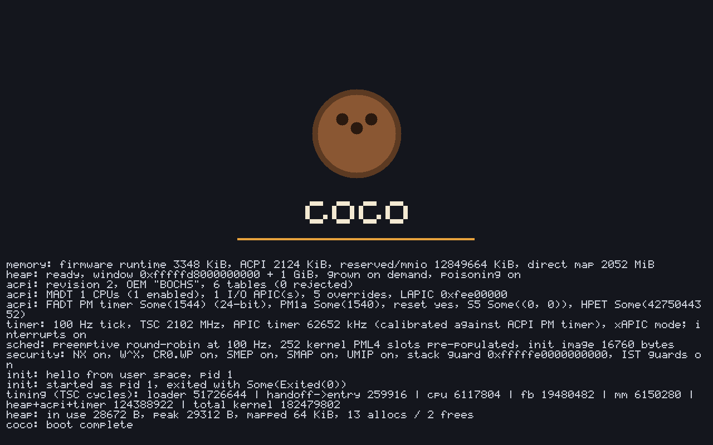

# coco OS

**Compact · Composable · Secure · Fast · Intuitive**

coco is an independent operating system written from scratch in Rust: its
own UEFI loader, its own kernel, its own boot protocol — no Linux, BSD,
XNU, Windows or Redox underneath. The full kernel targets x86_64 UEFI
machines; a portable bring-up kernel already boots on **RISC-V 64,
RISC-V 32, AArch64 and 32-bit x86** (see [ADR 0015](docs/adr/0015-multi-architecture-ports.md)).

> **Status: M0–M4 complete — EXPERIMENTAL, NOT RELEASE READY.**
> coco boots in QEMU/OVMF and runs its first user program as pid 1. It has
> exception handling, a frame allocator, page tables and a hardened heap,
> ACPI discovery, a calibrated APIC timer, a preemptive scheduler, isolated
> user processes with system calls, capability-based handles, channel IPC
> with a first user-space service, and ACPI reboot/power-off. It has no
> filesystem, drivers or applications yet and has never run on physical
> hardware.
> The RISC-V, AArch64 and 32-bit x86 ports run the shared frame allocator,
> heap, capabilities and IPC with traps and timer interrupts, but with the
> MMU off and no user mode yet.
> See [docs/quality-report.md](docs/quality-report.md).



## What exists

| Component | Path | Notes |
|---|---|---|
| UEFI loader | `boot/` | reads and validates the kernel, builds W^X page tables, exits boot services, hands off |
| Kernel | `kernel/` | GDT/TSS/IDT (256 vectors, guarded IST), fault diagnostics, framebuffer console, frame allocator, heap, ACPI, local APIC + 100 Hz timer, preemptive scheduler, processes, SYSCALL/SYSRET, reboot/S5, self-tests |
| First user program | `user/init/` | ring-3 `init` (pid 1); also the user-mode test workload |
| ACPI parser | `crates/coco-acpi/` | RSDP/XSDT/MADT/FADT/HPET/`_S5`, no allocation, no `unsafe`, fuzzed |
| Boot protocol | `crates/coco-abi/` | versioned `BootInfo`, memory map normalisation, cmdline parsing |
| ELF parser | `crates/coco-elf/` | strict, allocation-free, fuzzed |
| Capabilities | `crates/coco-capability/` | handle tables: rights, generations, attenuation |
| IPC | `crates/coco-ipc/` | channel state machine: bounded queues, handle transfer, peer-closed |
| Memory | `crates/coco-memory/` | bitmap frame allocator, 4-level page-table mapper, hardened heap |
| Sync | `crates/coco-sync/` | spin lock, Loom-checked |
| Arch | `arch/x86_64/` | privileged instructions, descriptors, 16550 UART |
| Portable bring-up kernel | `ports/coco-port/` | RISC-V 64 (S-mode/OpenSBI), RISC-V 32 (M-mode), AArch64 (EL1, GICv2), x86 32-bit (Multiboot): traps, timer, frames, heap, capabilities, IPC |
| Device tree | `crates/coco-fdt/` | flattened device-tree reader, no allocation, no `unsafe`, fuzzed |
| Tooling | `tools/xtask/` | build, GPT/FAT image, size gate, QEMU test matrix, reproducibility check |

Base image today: **212,480 bytes** of the 108,000,000-byte budget
(see [docs/size-report.md](docs/size-report.md)).

## Quick start

```bash
cargo xtask build        # loader + kernel + disk image + size report
cargo xtask qemu-test    # boot test matrix under QEMU/OVMF
cargo xtask run          # interactive boot, serial on stdio
cargo xtask port-test    # boot the RISC-V 64/32, AArch64 and x86 ports
cargo xtask cross-test   # portable crates' tests on 32-bit x86, AArch64, RISC-V 64
```

Requirements and every other command: [docs/building.md](docs/building.md).

## Documentation

* [Architecture decisions](docs/adr/)
* [Kernel safety invariants](docs/kernel-safety-invariants.md)
* [Threat model](docs/threat-model.md)
* [Hardware compatibility](docs/hardware-compatibility.md)
* [Feature matrix](docs/feature-matrix.md)
* [Benchmarks](docs/benchmarks.md)
* [Known limitations](docs/known-limitations.md)
* [Quality report](docs/quality-report.md)
